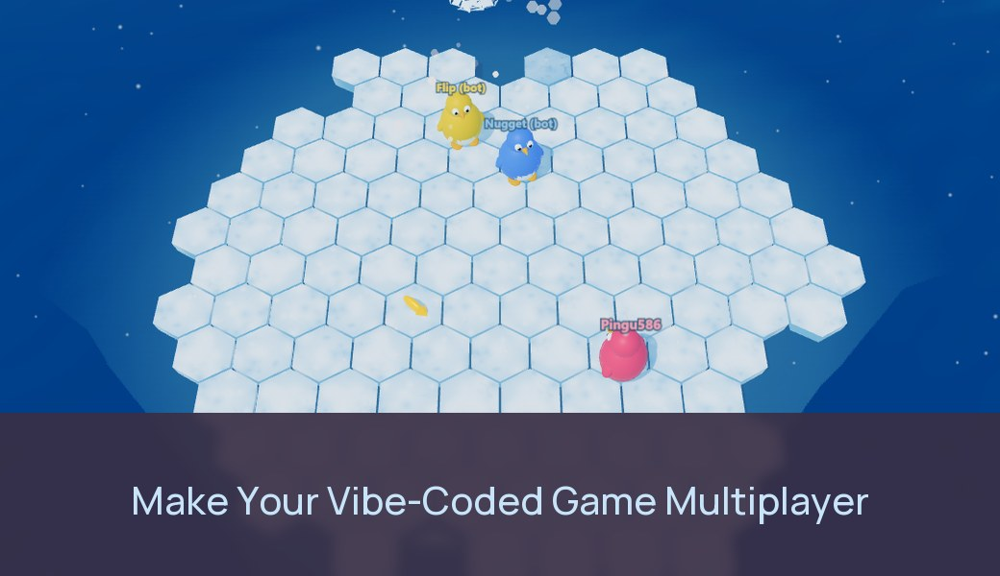

# Thin Ice Tussle: a vibe-coded game made online multiplayer on Edgegap

## ▶ Play it now: [edgegap.github.io/netcode-sample-threejs-thin-ice-tussle](https://edgegap.github.io/netcode-sample-threejs-thin-ice-tussle/)

[](https://edgegap.github.io/netcode-sample-threejs-thin-ice-tussle/)

**This is a live game with a live matchmaker.** Open the link, click **Play online** and you join a real queue on Edgegap's matchmaker:

- Players who queue around the same time land in the same match (2 to 4 players). If nobody else is searching, you get a match against bots after about 20 seconds.
- Every match starts its own game server on Edgegap, placed near the players, and that server stops itself as soon as the match ends or everyone leaves. Only the matchmaker runs all the time.
- Grab a friend: open the link on two devices (a phone and a laptop work) and click **Play online** within a few seconds of each other.
- No account and no install; it runs in the browser on desktop and mobile. **Practice vs bots** works offline, without the matchmaker.
- Questions, or want this for your own game? Use the **Contact Edgegap** button in the game, [our Discord](https://discord.gg/MmJf8fWjnt), or info@edgegap.com.

## What this is

Thin Ice Tussle is a small Three.js browser game. Up to four waddlers slide around a sheet of hexagonal ice that breaks up from the edge inward, and belly-slide into each other to shove rivals into the sea. Last one standing wins the round; first to 4 rounds wins. It was first built as a single-player game against bots, the way a vibe coder would build it. Then an AI agent (Claude Code) with the Edgegap MCP server connected turned it into online multiplayer: each match runs on its own authoritative server, placed near its players, started by the Edgegap matchmaker and stopped as soon as the match is over or empty. Every line in this repo was written by the agent; the prompts are in [PROMPTS.md](PROMPTS.md).

Fall in and an orca will be waiting.

## Before and after

- [`before`](../../tree/before): the single-player game. Plain HTML and JS, Three.js from a CDN, no build step.
- [`after`](../../tree/after): the same game with online matches on Edgegap. Solo play still works.
- [The diff](../../compare/before...after): what it took to go online.

The game rules (`client/rules.js`) did not change. In the `after` version the server runs that same file and owns the match: players only send inputs, and the page draws what the server sends back.

## Do this with your own game

1. Connect the Edgegap MCP server to your agent (Claude Code, Codex, Cursor, ChatGPT...): `https://mcp.edgegap.dev/mcp`, or locally with `npx @edgegap/mcp`. It needs an Edgegap API token, which stays in the agent's settings and never goes into your game.
2. Open your game's folder and give the agent one prompt, for example:

   > Make this game online multiplayer on Edgegap. Use the Edgegap MCP and its edgegap-threejs skill. Keep the solo mode, add a Find Match button. Ask me before you create anything in my Edgegap account.

The agent loads the [`edgegap-threejs`](https://github.com/edgegap/llm-agent-skills) skill through the MCP and follows it: a Node.js server per match, Find Match with the Edgegap JS SDK, a Dockerfile, a matchmaker config and tests. You do the account steps it can't: adding the registry login to the app version and creating the matchmaker in the dashboard.

## How it works

```
page --Find Match (Edgegap JS SDK)--> Edgegap matchmaker (runs all the time)
                                         | groups 2-4 players (a lone player after 20 s, with bots)
                                         v
                                    one game server near those players
page <--wss://<id>.pr.edgegap.net:<port>-- game server: 60 Hz simulation, 20 Hz snapshots
                                         | match over, nobody joined, or everyone left
                                         v
                                    server stops its own deployment: billing stops
```

- **Matchmaker** (`matchmaker/floe.json`): one profile, `floe`, 2 to 4 players. Edgegap starts the server near the matched players. It is the only part that runs non-stop.
- **Server** (`server/`): one Node.js process per match. It reads Edgegap's injected variables, listens on port 7777 on `0.0.0.0`, fills empty seats with bots and only admits players the matchmaker sent it (`REQUIRE_TICKET=1`). It stops its own deployment 8 s after the match ends, 10 s after the last player leaves, or 45 s after starting if nobody connects, and exits cleanly on SIGTERM. Restart policy `never`, max duration 30 minutes as a backstop.
- **Client** (`client/`): a static page. It only talks to the matchmaker (with the matchmaker's client token, made to ship in games) and to its match's server. The Edgegap API token is never in the page.
- **Port**: WebSocket with TLS Upgrade, so a page on `https` connects with `wss://`; the page retries the first connection while a fresh server boots.

## Run it locally

Needs Node.js 22 and, for the container tests, Docker.

```bash
npm ci
```

```bash
node server/main.js
```

```bash
npx http-server client -p 8081
```

Open http://localhost:8081 in two tabs and click **Local server :7777** in both (that button only shows on localhost). Off Edgegap the server never stops; matches loop.

Tests:

```bash
node tests/local-match.mjs
```

```bash
IMAGE=thin-ice-tussle:dev READY="listening on" CLIENT_CMD='SERVER_URL=ws://$SERVER_HOST:$SERVER_PORT node tests/local-match.mjs' SELF_STOP_ENV=FIRST_JOIN_TIMEOUT_S=4 bash tests/parity.sh
```

```bash
MM_URL=https://<matchmaker>.edgegap.net MM_TOKEN=<matchmaker auth token> node tests/e2e.mjs floe 2
```

- `local-match.mjs`: two headless players play a full match on a local server.
- `parity.sh`: the server image run the way Edgegap runs it (injected variables, a random outside port, two servers on one host, secrets in logs, SIGTERM, self-stop). Build the image first with `docker build --platform linux/amd64 -f server/Dockerfile -t thin-ice-tussle:dev .`
- `e2e.mjs`: two headless players go through the real matchmaker, play a whole match on Edgegap and check the server stopped itself. `SERVER_URL=wss://...` tests one deployment without the matchmaker.

## Ship a new server build

Pushing to `main` builds the image and pushes it to the Edgegap Container Registry with a UTC timestamp tag (`.github/workflows/server-image.yml`; secrets `EDGEGAP_REGISTRY_USERNAME`, `EDGEGAP_REGISTRY_TOKEN`, variable `EDGEGAP_REGISTRY_PROJECT`). Point the app version at the new tag (dashboard, the MCP's `edgegap_update_app_version`, or [edgegap/deploy-action](https://github.com/edgegap/deploy-action)); running matches keep the old build. Changes under `client/` publish to GitHub Pages (`.github/workflows/pages.yml`).

## Questions

[Edgegap on Discord](https://discord.gg/MmJf8fWjnt) or info@edgegap.com.

## License

MIT
